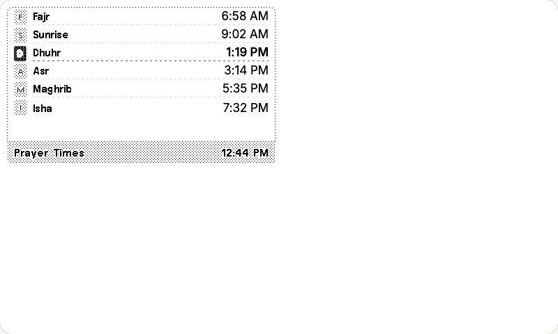

# Salah Times for TRMNL

A TRMNL plugin that shows today's five daily prayers and sunrise for your location, with the next prayer highlighted.


Prayer times come from the free [AlAdhan API](https://aladhan.com/prayer-times-api). TRMNL polls it directly, so there is no server to run.

## Settings

- **Location**: search for a city or postal code, or enter `lat,lon`.
- **Calculation method**: the authority whose angles set Fajr and Isha (default Muslim World League).
- **Asr method**: Standard (Shafi'i, Maliki, Hanbali) or Hanafi.
- **Time format**: 12-hour or 24-hour.

Set your TRMNL account time zone (Account → Preferences) to the time zone of the location. The plugin uses it for today's date, for the time zone of the returned prayer times, and to decide which prayer is next.

## Layouts

| Half horizontal | Half vertical | Quadrant |
| --- | --- | --- |
|  |  |  |

## How It Works

On each refresh TRMNL requests:

```
https://api.aladhan.com/v1/timings/{today}?latitude=…&longitude=…&method=…&school=…&timezonestring={account time zone}
```

`{today}` is computed in Liquid from `"now"` plus `trmnl.user.utc_offset`. The response is available to the markup as `data`.

[src/shared.liquid](src/shared.liquid) runs before every layout. It works out the local time, picks the first prayer later than now (wrapping to Fajr after Isha), and formats the times. The layouts in [src](src) only handle presentation.

## Files

- [src/settings.yml](src/settings.yml): plugin settings, polling URL and form fields, as exported from TRMNL
- [src/shared.liquid](src/shared.liquid): shared logic
- [src/full.liquid](src/full.liquid), [src/half_horizontal.liquid](src/half_horizontal.liquid), [src/half_vertical.liquid](src/half_vertical.liquid), [src/quadrant.liquid](src/quadrant.liquid): layouts
- [assets/icon.svg](assets/icon.svg): plugin icon

## Making Changes

Edit the files in `src/`, then paste each into the matching tab of the plugin's markup editor (Full, Half horizontal, Half vertical, Quadrant, Shared). Settings and form fields are on the plugin's settings page. After changing them in TRMNL, use **Export** and copy `settings.yml` back here.

## License

[MIT](LICENSE)
