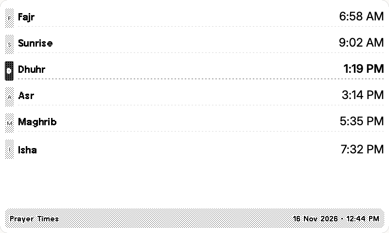
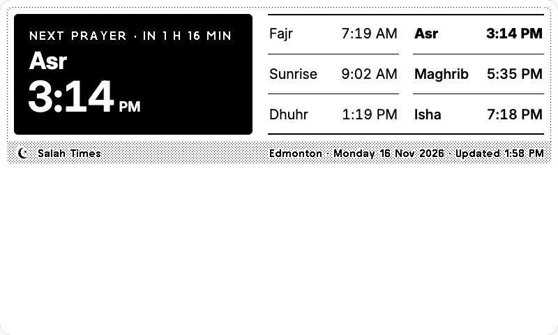
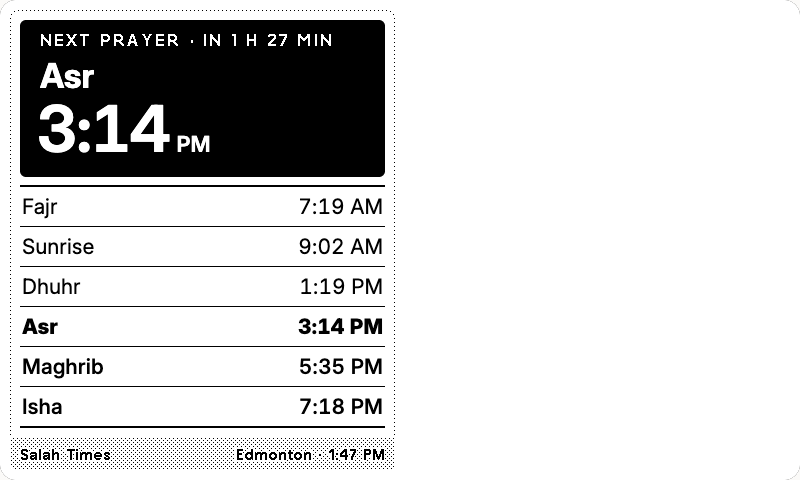

# Salah Times for TRMNL

A TRMNL plugin that shows today's prayer times for your location. The next prayer sits in a large black panel with a countdown, beside the day's schedule.



Prayer times come from the free [AlAdhan API](https://aladhan.com/prayer-times-api). TRMNL polls it directly, so there is no server to run.

## Settings

- **Location**: search for a city or postal code, or enter `lat,lon`.
- **Location name** (optional): shown in the title bar, for example `Edmonton`. TRMNL's location search only saves coordinates, so the name is typed separately.
- **Calculation method**: the authority whose angles set Fajr and Isha (default Muslim World League).
- **Asr method**: Standard (Shafi'i, Maliki, Hanbali) or Hanafi.
- **Time format**: 12-hour or 24-hour.

Set your TRMNL account time zone (Account → Preferences) to the time zone of the location. The plugin uses it for today's date, for the time zone of the returned prayer times, and to decide which prayer is next.

## What It Shows

- The next prayer, its time, and how long until it ("Next prayer · in 34 min"). After Isha it shows tomorrow's Fajr ("Tomorrow · in 9 h 49 min").
- Today's six times. Past prayers are regular weight, upcoming ones medium, and the next one bold, with a pointer from the panel in the full and quadrant layouts.
- On Fridays, Dhuhr is labelled Jumuʿah.
- The title bar shows the location, date and the time of the last refresh. TRMNL refreshes at most every 15 minutes, so the countdown can be up to 15 minutes old.

Everything is pure black and white for 1-bit e-ink. Each layout works in landscape and portrait, and sizes scale up on the TRMNL X.

## Layouts

| Half horizontal | Half vertical | Quadrant |
| --- | --- | --- |
|  |  |  |

## How It Works

On each refresh TRMNL requests:

```
https://api.aladhan.com/v1/timings/{today}?latitude=…&longitude=…&method=…&school=…&timezonestring={account time zone}&tune=0,0,0,0,0,0,0,0,{HHMM}
```

`{today}` and `{HHMM}` are computed in Liquid from `"now"` plus `trmnl.user.utc_offset`. The response is available to the markup as `data`.

TRMNL skips rendering when the polled data hasn't changed, and AlAdhan returns the same response all day, so without help the countdown and next prayer would freeze after the first render. The `tune` value shifts only Midnight, which the plugin doesn't show, by the current local time, so each refresh returns different data and the screen re-renders.

[src/shared.liquid](src/shared.liquid) runs before every layout. It works out the local time, picks the first prayer later than now (wrapping to Fajr after Isha), formats the times, and holds the styles for all layouts. The layout files in [src](src) are identical markup; CSS keyed on TRMNL's `view--<layout>` classes arranges each one.

## Files

- [src/settings.yml](src/settings.yml): plugin settings, polling URL and form fields, as exported from TRMNL
- [src/shared.liquid](src/shared.liquid): shared logic and styles
- [src/full.liquid](src/full.liquid), [src/half_horizontal.liquid](src/half_horizontal.liquid), [src/half_vertical.liquid](src/half_vertical.liquid), [src/quadrant.liquid](src/quadrant.liquid): layouts
- [tools/render.mjs](tools/render.mjs): local preview renderer
- [assets/icon.svg](assets/icon.svg): plugin icon

## Previewing Locally

`tools/render.mjs` renders the layouts with TRMNL's framework CSS and [LiquidJS](https://liquidjs.com), then screenshots them through a Chrome with remote debugging on `127.0.0.1:9333`:

```bash
cd tools && npm install && cd ..
NODE_PATH=tools/node_modules node tools/render.mjs src --time 21:30 --format 24 --location Edmonton --portrait
```

It writes `src/out/<layout>.png` and a contact sheet `src/out/sheet.png`. `--data` takes another AlAdhan response; the default is [tools/sample-aladhan.json](tools/sample-aladhan.json). `--portrait` renders the OG in portrait. Its output matches TRMNL's own preview for the OG; check the TRMNL X in TRMNL's markup editor, since the renderer doesn't reproduce that screen.

## Making Changes

Edit the files in `src/`, then paste each into the matching tab of the plugin's markup editor (Shared, Full, Half horizontal, Half vertical, Quadrant). Settings and form fields are on the plugin's settings page. After changing them in TRMNL, use **Export** and copy `settings.yml` back here.

## License

[MIT](LICENSE)
